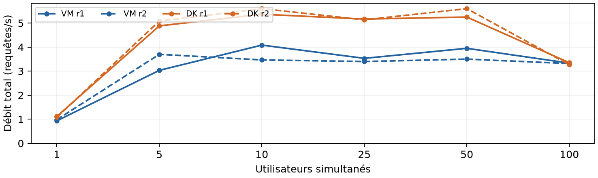
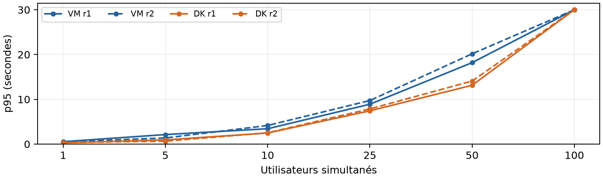
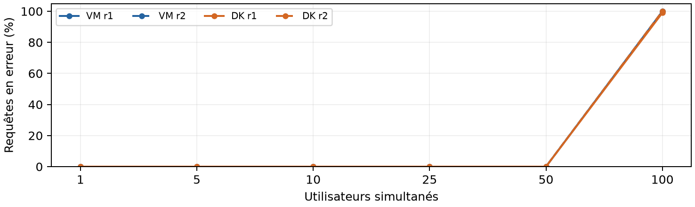

# MyHike - Rapport de comparaison VM / Docker

26/10/2026 - mesures réelles

## Protocole

Même poste Windows, même code applicatif, mêmes fichiers SQL et comptes figés, même plan JMeter 5.6.3 / Java 8u511. Chaque couche dispose de 1 CPU et 2 Gio de RAM (système invité compris pour les VM). Un seul déploiement fonctionne à la fois ; Docker Desktop est arrêté pendant les mesures VM. L'ordre des campagnes est VM r1, Docker r1, Docker r2, VM r2. Une sauvegarde privée et une réinitialisation SQL précèdent chaque série.

Une itération ouvre une session puis consulte 20 refuges authentifiés ; assertions HTTP, contenu et session, attente de 500 à 1 000 ms avant chaque requête. Paliers : 1, 5, 10, 25, 50 et 100 utilisateurs. Montée 10 s, fenêtre mesurée 60 s après le marqueur + 11 s, pause 10 s entre paliers. Les requêtes sont retenues par leur heure de départ ; leur durée complète est conservée. Les contrôles positif et mot de passe incorrect sont archivés pour chaque série.

## Synthèse

| Grandeur | VM | Docker |
| --- | --- | --- |
| Meilleur débit observé sans erreur | 3,77 req/s (10 u.) | 5,48 req/s (10 u.) |
| p95 moyen à 10 utilisateurs | 3,79 s | 2,50 s |
| Erreurs moyennes à 100 utilisateurs | 100,00 % | 99,50 % |
| Premier palier proche du plateau (1) | 10 utilisateurs | 5 utilisateurs |
| Composant limitant observé | Backend : CPU / pool | Backend : CPU / pool |
| Démarrage complet, médiane de 3 | 63,53 s | 26,86 s |
| Somme RSS hôte au repos, médiane | 2229 Mio | 3472 Mio |
| Pic mémoire backend observé | 972 Mio | 869 Mio |

La somme RSS mesure les processus hôtes identifiés, avec possibles pages partagées ; elle ne représente pas la RAM allouée. Le démarrage VM va de trois VM éteintes à l'API saine ; Docker inclut le démarrage de son moteur Linux puis des trois conteneurs. Ces durées comprennent l'orchestration et la résolution des contrôles de santé. Le repos est relevé après campagne et redémarrage. (1) Premier palier atteignant 90 % du meilleur débit moyen réussi : repère descriptif, pas un seuil de service acceptable.

## Étalonnage

VM : 470 à 736 req/s sur /index.html. DK : 5887 à 6318 req/s sur /index.html. Ce sont des bornes de capacité du couple injecteur/proxy, pas une mesure isolée du plafond de Java. Les métriques de Java et les erreurs sont conservées.

## Résultats

| Déploiement | u. | Débit r1 / r2 | p95 r1 / r2 (s) | Erreurs r1 / r2 (%) |
| --- | --- | --- | --- | --- |
| VM | 1 | 0,93 / 0,98 | 0,54 / 0,50 | 0,0 / 0,0 |
| VM | 5 | 3,03 / 3,70 | 2,13 / 1,37 | 0,0 / 0,0 |
| VM | 10 | 4,08 / 3,47 | 3,43 / 4,15 | 0,0 / 0,0 |
| VM | 25 | 3,53 / 3,40 | 8,90 / 9,73 | 0,0 / 0,0 |
| VM | 50 | 3,95 / 3,50 | 18,19 / 20,16 | 0,0 / 0,0 |
| VM | 100 | 3,33 / 3,32 | 30,00 / 30,00 | 100,0 / 100,0 |
| DK | 1 | 1,12 / 1,08 | 0,29 / 0,34 | 0,0 / 0,0 |
| DK | 5 | 4,88 / 5,08 | 0,93 / 0,65 | 0,0 / 0,0 |
| DK | 10 | 5,37 / 5,60 | 2,47 / 2,53 | 0,0 / 0,0 |
| DK | 25 | 5,17 / 5,13 | 7,43 / 7,86 | 0,0 / 0,0 |
| DK | 50 | 5,25 / 5,60 | 13,14 / 14,08 | 0,0 / 0,0 |
| DK | 100 | 3,35 / 3,27 | 30,01 / 30,02 | 99,0 / 100,0 |

Écart relatif = |r1 - r2| / moyenne × 100, calculé séparément sur le débit et le p95. Dépassement du seuil de 10 % : VM 5 u., VM 10 u., VM 50 u., DK 1 u., DK 5 u.. Ces paliers restent publiés ; aucun meilleur essai n'est sélectionné pour masquer la variation.

## Écarts chiffrés

Le meilleur débit sans erreur observé vaut 3,77 req/s en VM et 5,48 req/s sous Docker, aux charges indiquées page 1. À 10 utilisateurs, le p95 moyen est respectivement 3,79 s et 2,50 s. Ces moyennes décrivent deux essais ; ce ne sont pas des garanties de capacité durable.

## Explications

Les VM exécutent trois systèmes invités, tandis que les conteneurs partagent le noyau de la VM Linux de Docker Desktop. Le coût de l'ordonnancement et du réseau diffère. Les versions de Python (VM 3.12 / Docker 3.14), MySQL (8.0 / 8.4) et Nginx diffèrent également : les résultats comparent ces installations concrètes, sans isoler l'effet de la virtualisation.

## Composant limitant

VM : CPU moyen backend jusqu'à 95,1 % d'un cœur, contre 13,6 % pour MySQL ; maximum 16 connexions, surveillance comprise. Les journaux confirment un pool SQLAlchemy de 5 + 10 connexions épuisé. DK : CPU moyen backend jusqu'à 102,3 % d'un cœur, contre 8,3 % pour MySQL ; maximum 16 connexions, surveillance comprise. Les journaux confirment un pool SQLAlchemy de 5 + 10 connexions épuisé. Le pool est une limite applicative : cela ne prouve pas la saturation du moteur MySQL. Les courbes et les métriques par palier permettent de distinguer le ralentissement préalable de l'échec à forte charge. Après la première surcharge Docker, le backend était unhealthy sans OOM ; un redémarrage hors mesure a précédé la réinitialisation de la série suivante.

## Limites

Deux répétitions de 60 s ne couvrent ni l'endurance ni la disponibilité, les pannes ou une distribution multi-hôtes. Le poste héberge aussi l'injecteur ; les tâches de fond, caches et températures ne sont pas parfaitement contrôlés. Les temporisations client plafonnent les latences d'échec autour de 30 s. Les versions et les modalités de quotas/swap diffèrent. Les anciennes mesures sur le PC de Rémi restent historiques et sont exclues de cette comparaison.

## Validation et traçabilité

Mesures et contrôles CLI archivés. Les captures de validation dans l'interface JMeter restent à réaliser : l'outil de contrôle Windows a refusé l'accès à Java, même après l'accord utilisateur. Les plans GUI positif/négatif sont fournis ; aucun succès graphique n'est affirmé. Traçabilité : configuration.json (empreintes), PROTOCOLE.md, etapes/*-resultat.json, *-serveur.jsonl et *-backend.txt, calibration/, baseline-vm.json et baseline-dk.json. Les CSV bruts vm/dk portant l'identifiant 20261026-152151 sont dans bruts/charge ; l'étalonnage est dans bruts/etalonnage. Les données anciennes restent inchangées.
