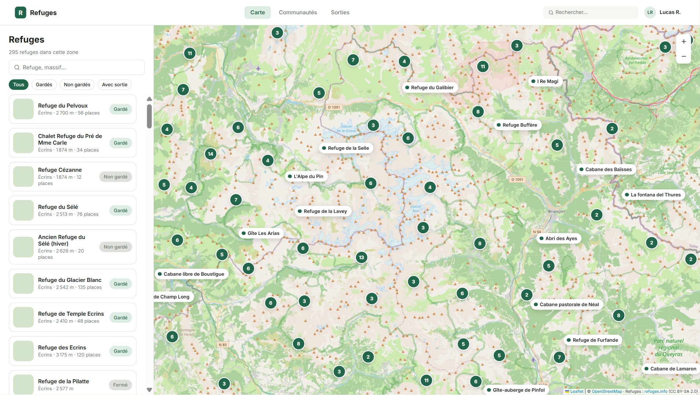
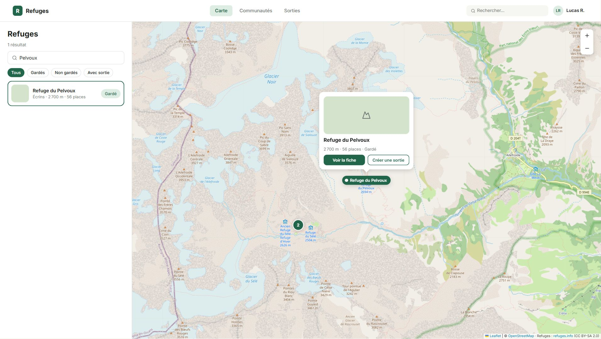
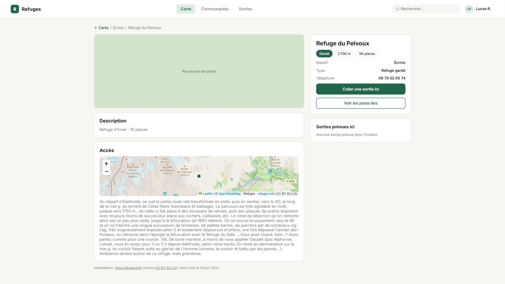
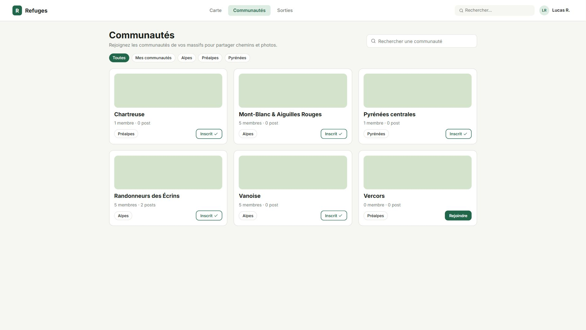
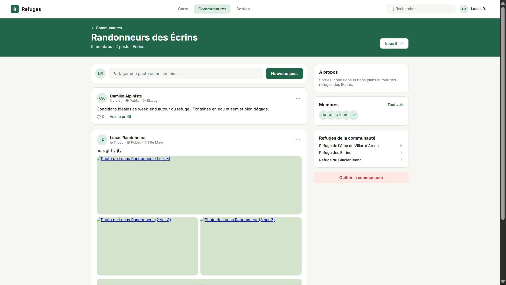
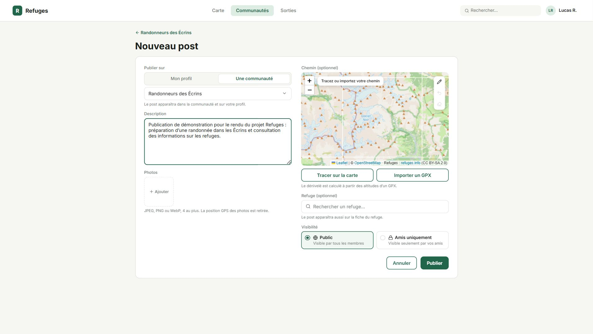
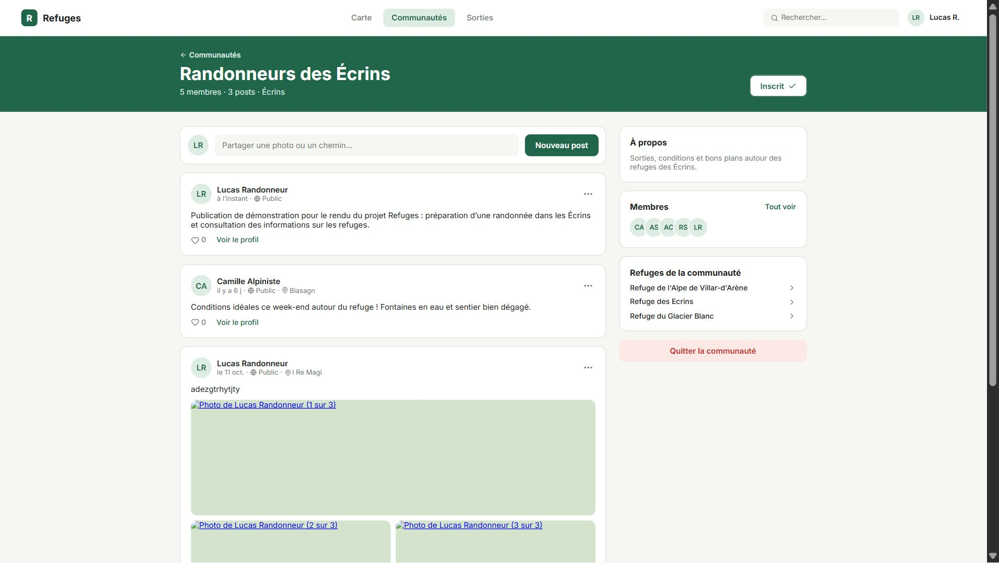
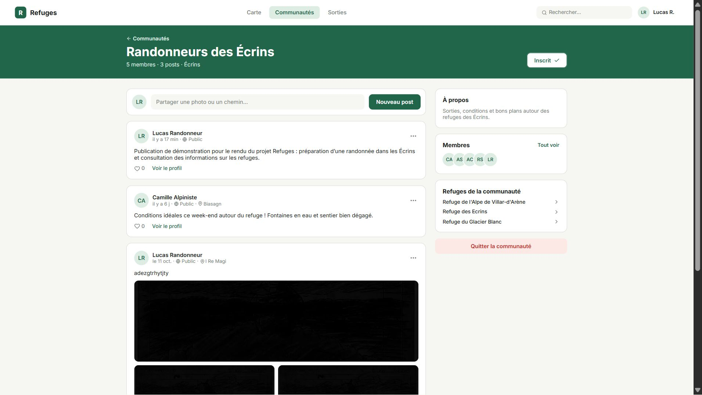

# Deux parcours dans l’application Refuges

**Projet :** Refuges  
**Binôme :** Akrem SOUSSI et Rémi CORTIAL

Ces captures proviennent de l’application exécutée sur le poste de Rémi, avec les trois services Docker du projet `refuges-validation`, sur `http://localhost:8080`. La version du code est `ccd5108`. La session du compte de démonstration **Lucas Randonneur** (`randonneur`) était déjà ouverte. Les images montrent l’interface réelle, sans reconstitution graphique. Les marges vides extérieures ont été recadrées ; le contenu de l’interface n’a pas été retouché.

## Parcours 1 — Rechercher un refuge et consulter sa fiche

**Objectif :** retrouver un refuge par son nom et consulter ses informations pratiques. Ce parcours illustre le cas CU3 et le test T06 du cahier de recette.

### 1. Ouvrir la carte

La carte affiche les marqueurs regroupés et une liste de refuges. Le nombre de 295 correspond à la zone visible, pas à la totalité de la base.

### 2. Rechercher « Pelvoux » et sélectionner le résultat

La recherche retourne un résultat. La sélection centre la carte sur le refuge et ouvre une fenêtre proposant l’accès à sa fiche.

### 3. Ouvrir « Voir la fiche »

La fiche présente le refuge du Pelvoux : massif des Écrins, altitude de 2 700 m, capacité de 56 places, statut gardé, description et accès. L’état « Pas encore de photo » est affiché pour ce refuge.

**Résultat observé :** la recherche, la sélection sur la carte et l’ouverture de la fiche fonctionnent.

## Parcours 2 — Publier dans une communauté

**Objectif :** accéder à une communauté et y publier un message. Ce parcours illustre CU4 ; il couvre la publication textuelle, sans prétendre réexécuter le test T08 complet avec photo et GPX.

### 1. Consulter les communautés

L’onglet Communautés présente les six communautés, leurs compteurs et l’état d’adhésion du compte connecté.

### 2. Ouvrir « Randonneurs des Écrins »

Le compte est déjà membre de cette communauté. Sa page affiche cinq membres, deux posts avant l’essai, les refuges associés et le bouton « Nouveau post ».

### 3. Rédiger le message

Depuis « Nouveau post », la communauté est présélectionnée. Le message est identifié comme une démonstration pour le rendu et la visibilité Public est conservée. Aucune photo ni trace GPX n’est ajoutée.

### 4. Publier et recharger la page

Après clic sur « Publier », l’application revient dans la communauté. Le message apparaît sous le nom de Lucas Randonneur et le compteur passe de deux à trois posts. Un rechargement confirme que le message a été conservé.

**Résultat observé :** la publication textuelle est enregistrée et affichée dans la communauté. Ce message de démonstration est conservé dans la base Docker locale ; il n’a pas été ajouté au peuplement SQL du dépôt ni aux OVA.

## Portée de ces preuves

Ces deux parcours ont été exécutés dans le navigateur. Ils complètent la recette historique sans constituer une nouvelle validation de tous ses tests. Les captures initiales montrent trois images manquantes sur un ancien post. Leurs fichiers ont ensuite été retrouvés dans la sauvegarde locale et restaurés dans le volume Docker : les trois URL renvoient désormais HTTP 200 et les fichiers servis sont identiques aux originaux. Aucun résultat JMeter n’a été modifié.

### Vérification après restauration des médias

Les trois images originales sont à nouveau chargées. Elles sont très sombres dans les fichiers sources ; aucune retouche ni substitution n’a été effectuée.

