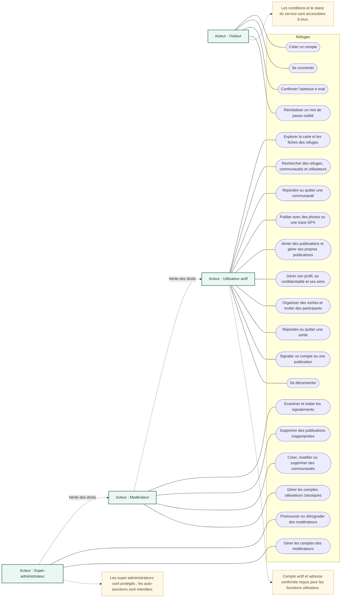
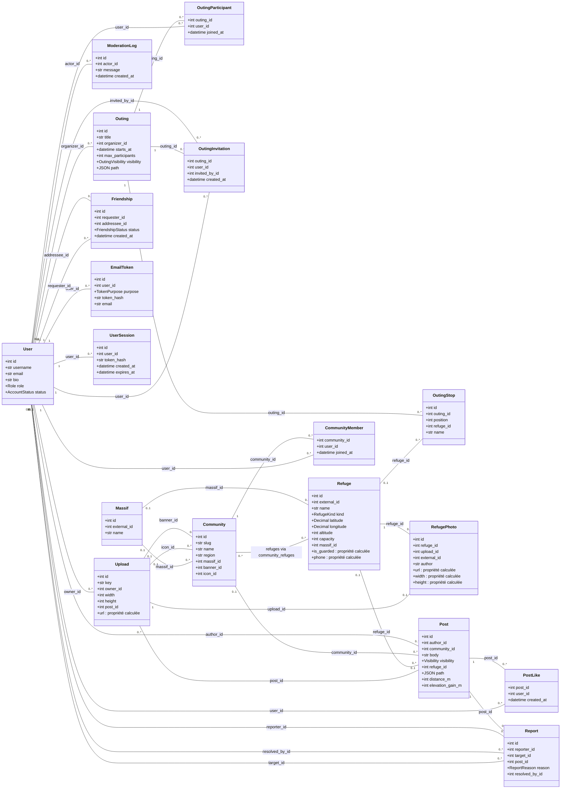
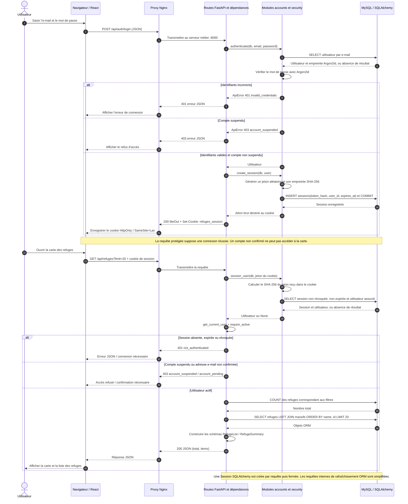
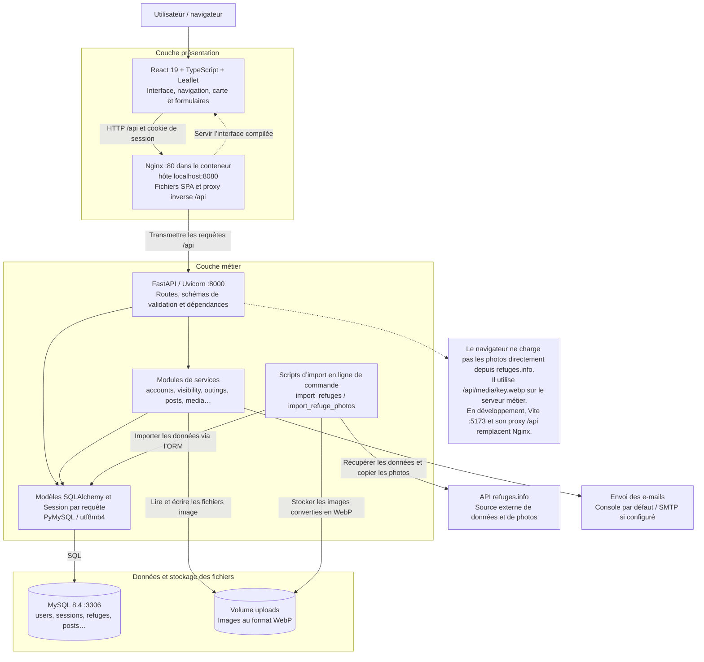

# Refuges — Code Mermaid de tous les diagrammes

**Projet :** Refuges  
**Binôme :** Akrem SOUSSI et Rémi CORTIAL

Chaque bloc est autonome : copier un seul bloc à la fois dans un éditeur Mermaid.
Les libellés sont en français ; les identifiants techniques correspondent au projet.

**Cas d’utilisation :** Mermaid ne possède pas de notation UML native pour ce type de diagramme.
La version ci-dessous utilise `flowchart` pour représenter les acteurs, les objectifs et l’héritage des droits.
La version UML formelle reste disponible dans `02-use-cases.puml`.

## Relations de la base de données

Diagramme entité-association : tables applicatives, clés, liens facultatifs et cardinalités.

```mermaid
erDiagram
    communities {
        bigint id PK "obligatoire"
        varchar name "obligatoire"
        bigint massif_id FK "facultatif"
        bigint banner_id FK "facultatif"
        bigint icon_id FK "facultatif"
    }
    community_members {
        bigint community_id PK, FK "obligatoire"
        bigint user_id PK, FK "obligatoire"
    }
    community_refuges {
        bigint community_id PK, FK "obligatoire"
        bigint refuge_id PK, FK "obligatoire"
    }
    email_tokens {
        bigint id PK "obligatoire"
        bigint user_id FK "obligatoire"
        varchar email "obligatoire"
    }
    friendships {
        bigint id PK "obligatoire"
        bigint requester_id FK "obligatoire"
        bigint addressee_id FK "obligatoire"
        enum status "obligatoire"
    }
    massifs {
        bigint id PK "obligatoire"
        varchar name "obligatoire"
    }
    moderation_log {
        bigint id PK "obligatoire"
        bigint actor_id FK "facultatif"
    }
    outing_invitations {
        bigint outing_id PK, FK "obligatoire"
        bigint user_id PK, FK "obligatoire"
        bigint invited_by_id FK "obligatoire"
    }
    outing_participants {
        bigint outing_id PK, FK "obligatoire"
        bigint user_id PK, FK "obligatoire"
    }
    outing_stops {
        bigint id PK "obligatoire"
        bigint outing_id FK "obligatoire"
        bigint refuge_id FK "facultatif"
        varchar name "obligatoire"
    }
    outings {
        bigint id PK "obligatoire"
        varchar title "obligatoire"
        bigint organizer_id FK "obligatoire"
        enum visibility "obligatoire"
    }
    post_likes {
        bigint post_id PK, FK "obligatoire"
        bigint user_id PK, FK "obligatoire"
    }
    posts {
        bigint id PK "obligatoire"
        bigint author_id FK "obligatoire"
        bigint community_id FK "facultatif"
        enum visibility "obligatoire"
        bigint refuge_id FK "facultatif"
    }
    refuge_photos {
        bigint id PK "obligatoire"
        bigint refuge_id FK "obligatoire"
        bigint upload_id FK, UK "obligatoire"
    }
    refuges {
        bigint id PK "obligatoire"
        varchar name "obligatoire"
        bigint massif_id FK "facultatif"
    }
    reports {
        bigint id PK "obligatoire"
        bigint reporter_id FK "obligatoire"
        bigint target_id FK "obligatoire"
        bigint post_id FK "facultatif"
        enum reason "obligatoire"
        bigint resolved_by_id FK "facultatif"
    }
    sessions {
        bigint id PK "obligatoire"
        bigint user_id FK "obligatoire"
    }
    uploads {
        bigint id PK "obligatoire"
        varchar key UK "obligatoire"
        bigint owner_id FK "facultatif"
        bigint post_id FK "facultatif"
    }
    users {
        bigint id PK "obligatoire"
        varchar username UK "obligatoire"
        varchar email UK "obligatoire"
        enum role "obligatoire"
        enum status "obligatoire"
    }
    uploads |o..o{ communities : "banner_id"
    uploads |o..o{ communities : "icon_id"
    massifs |o..o{ communities : "massif_id"
    communities ||--o{ community_members : "community_id"
    users ||--o{ community_members : "user_id"
    communities ||--o{ community_refuges : "community_id"
    refuges ||--o{ community_refuges : "refuge_id"
    users ||..o{ email_tokens : "user_id"
    users ||..o{ friendships : "addressee_id"
    users ||..o{ friendships : "requester_id"
    users |o..o{ moderation_log : "actor_id"
    users ||..o{ outing_invitations : "invited_by_id"
    outings ||--o{ outing_invitations : "outing_id"
    users ||--o{ outing_invitations : "user_id"
    outings ||--o{ outing_participants : "outing_id"
    users ||--o{ outing_participants : "user_id"
    outings ||..o{ outing_stops : "outing_id"
    refuges |o..o{ outing_stops : "refuge_id"
    users ||..o{ outings : "organizer_id"
    posts ||--o{ post_likes : "post_id"
    users ||--o{ post_likes : "user_id"
    users ||..o{ posts : "author_id"
    communities |o..o{ posts : "community_id"
    refuges |o..o{ posts : "refuge_id"
    refuges ||..o{ refuge_photos : "refuge_id"
    uploads ||..o| refuge_photos : "upload_id"
    massifs |o..o{ refuges : "massif_id"
    posts |o..o{ reports : "post_id"
    users ||..o{ reports : "reporter_id"
    users |o..o{ reports : "resolved_by_id"
    users ||..o{ reports : "target_id"
    users ||..o{ sessions : "user_id"
    users |o..o{ uploads : "owner_id"
    posts |o..o{ uploads : "post_id"
```

## Cas d’utilisation

Acteurs, fonctionnalités et héritage des droits selon les règles réellement implémentées.

## Classes métier

Classes SQLAlchemy réelles, principaux attributs, associations et propriétés calculées.

## Séquence des requêtes

Connexion, création du cookie de session, contrôle des droits et consultation des refuges.

## Architecture trois tiers

Interface, proxy inverse, serveur métier, stockage SQL et services externes.

## Schéma SQL complet

Toutes les tables et colonnes de schema.sql, y compris le suivi de version Alembic.

```mermaid
erDiagram
    alembic_version {
        varchar version_num PK "obligatoire"
    }
    communities {
        bigint id PK "obligatoire"
        varchar slug UK "obligatoire"
        varchar name "obligatoire"
        text description "obligatoire"
        varchar region "obligatoire"
        bigint massif_id FK "facultatif"
        datetime created_at "obligatoire"
        bigint banner_id FK "facultatif"
        bigint icon_id FK "facultatif"
    }
    community_members {
        bigint community_id PK, FK "obligatoire"
        bigint user_id PK, FK "obligatoire"
        datetime joined_at "obligatoire"
    }
    community_refuges {
        bigint community_id PK, FK "obligatoire"
        bigint refuge_id PK, FK "obligatoire"
    }
    email_tokens {
        bigint id PK "obligatoire"
        bigint user_id FK "obligatoire"
        enum purpose "obligatoire"
        varchar token_hash UK "obligatoire"
        varchar email "obligatoire"
        datetime created_at "obligatoire"
        datetime expires_at "obligatoire"
        datetime used_at "facultatif"
    }
    friendships {
        bigint id PK "obligatoire"
        bigint requester_id FK "obligatoire"
        bigint addressee_id FK "obligatoire"
        enum status "obligatoire"
        datetime created_at "obligatoire"
        datetime responded_at "facultatif"
    }
    massifs {
        bigint id PK "obligatoire"
        int external_id UK "obligatoire"
        varchar name "obligatoire"
    }
    moderation_log {
        bigint id PK "obligatoire"
        bigint actor_id FK "facultatif"
        varchar message "obligatoire"
        datetime created_at "obligatoire"
    }
    outing_invitations {
        bigint outing_id PK, FK "obligatoire"
        bigint user_id PK, FK "obligatoire"
        bigint invited_by_id FK "obligatoire"
        datetime created_at "obligatoire"
    }
    outing_participants {
        bigint outing_id PK, FK "obligatoire"
        bigint user_id PK, FK "obligatoire"
        datetime joined_at "obligatoire"
    }
    outing_stops {
        bigint id PK "obligatoire"
        bigint outing_id FK "obligatoire"
        int position "obligatoire"
        bigint refuge_id FK "facultatif"
        varchar name "obligatoire"
        decimal latitude "obligatoire"
        decimal longitude "obligatoire"
    }
    outings {
        bigint id PK "obligatoire"
        varchar title "obligatoire"
        bigint organizer_id FK "obligatoire"
        datetime starts_at "obligatoire"
        int max_participants "obligatoire"
        enum visibility "obligatoire"
        json path "obligatoire"
        datetime created_at "obligatoire"
    }
    post_likes {
        bigint post_id PK, FK "obligatoire"
        bigint user_id PK, FK "obligatoire"
        datetime created_at "obligatoire"
    }
    posts {
        bigint id PK "obligatoire"
        bigint author_id FK "obligatoire"
        bigint community_id FK "facultatif"
        text body "obligatoire"
        enum visibility "obligatoire"
        datetime created_at "obligatoire"
        bigint refuge_id FK "facultatif"
        json path "facultatif"
        int distance_m "facultatif"
        int elevation_gain_m "facultatif"
    }
    refuge_photos {
        bigint id PK "obligatoire"
        bigint refuge_id FK "obligatoire"
        bigint upload_id FK, UK "obligatoire"
        int external_id UK "obligatoire"
        varchar author "obligatoire"
        varchar caption "obligatoire"
        datetime taken_at "facultatif"
        int position "obligatoire"
    }
    refuges {
        bigint id PK "obligatoire"
        int external_id UK "obligatoire"
        varchar name "obligatoire"
        enum kind "obligatoire"
        decimal latitude "obligatoire"
        decimal longitude "obligatoire"
        int altitude "facultatif"
        int capacity "facultatif"
        bigint massif_id FK "facultatif"
        varchar state "facultatif"
        text access "facultatif"
        text remarks "facultatif"
        text owner_info "facultatif"
        varchar source_url "facultatif"
        datetime source_updated_at "facultatif"
        datetime imported_at "obligatoire"
        datetime photos_checked_at "facultatif"
    }
    reports {
        bigint id PK "obligatoire"
        bigint reporter_id FK "obligatoire"
        bigint target_id FK "obligatoire"
        bigint post_id FK "facultatif"
        enum reason "obligatoire"
        text comment "obligatoire"
        datetime created_at "obligatoire"
        datetime resolved_at "facultatif"
        bigint resolved_by_id FK "facultatif"
    }
    sessions {
        bigint id PK "obligatoire"
        bigint user_id FK "obligatoire"
        varchar token_hash UK "obligatoire"
        datetime created_at "obligatoire"
        datetime expires_at "obligatoire"
        datetime revoked_at "facultatif"
    }
    uploads {
        bigint id PK "obligatoire"
        varchar key UK "obligatoire"
        bigint owner_id FK "facultatif"
        int width "obligatoire"
        int height "obligatoire"
        bigint post_id FK "facultatif"
        smallint position "obligatoire"
        datetime created_at "obligatoire"
    }
    users {
        bigint id PK "obligatoire"
        varchar username UK "obligatoire"
        varchar email UK "obligatoire"
        varchar password_hash "obligatoire"
        varchar display_name "obligatoire"
        enum role "obligatoire"
        enum status "obligatoire"
        datetime created_at "obligatoire"
        datetime email_verified_at "facultatif"
        datetime suspended_at "facultatif"
        enum default_post_visibility "obligatoire"
        enum friends_list_audience "obligatoire"
        enum outings_audience "obligatoire"
        enum friend_requests_from "obligatoire"
        tinyint show_in_suggestions "obligatoire"
        varchar bio "obligatoire"
    }
    uploads |o..o{ communities : "banner_id"
    uploads |o..o{ communities : "icon_id"
    massifs |o..o{ communities : "massif_id"
    communities ||--o{ community_members : "community_id"
    users ||--o{ community_members : "user_id"
    communities ||--o{ community_refuges : "community_id"
    refuges ||--o{ community_refuges : "refuge_id"
    users ||..o{ email_tokens : "user_id"
    users ||..o{ friendships : "addressee_id"
    users ||..o{ friendships : "requester_id"
    users |o..o{ moderation_log : "actor_id"
    users ||..o{ outing_invitations : "invited_by_id"
    outings ||--o{ outing_invitations : "outing_id"
    users ||--o{ outing_invitations : "user_id"
    outings ||--o{ outing_participants : "outing_id"
    users ||--o{ outing_participants : "user_id"
    outings ||..o{ outing_stops : "outing_id"
    refuges |o..o{ outing_stops : "refuge_id"
    users ||..o{ outings : "organizer_id"
    posts ||--o{ post_likes : "post_id"
    users ||--o{ post_likes : "user_id"
    users ||..o{ posts : "author_id"
    communities |o..o{ posts : "community_id"
    refuges |o..o{ posts : "refuge_id"
    refuges ||..o{ refuge_photos : "refuge_id"
    uploads ||..o| refuge_photos : "upload_id"
    massifs |o..o{ refuges : "massif_id"
    posts |o..o{ reports : "post_id"
    users ||..o{ reports : "reporter_id"
    users |o..o{ reports : "resolved_by_id"
    users ||..o{ reports : "target_id"
    users ||..o{ sessions : "user_id"
    users |o..o{ uploads : "owner_id"
    posts |o..o{ uploads : "post_id"
```

