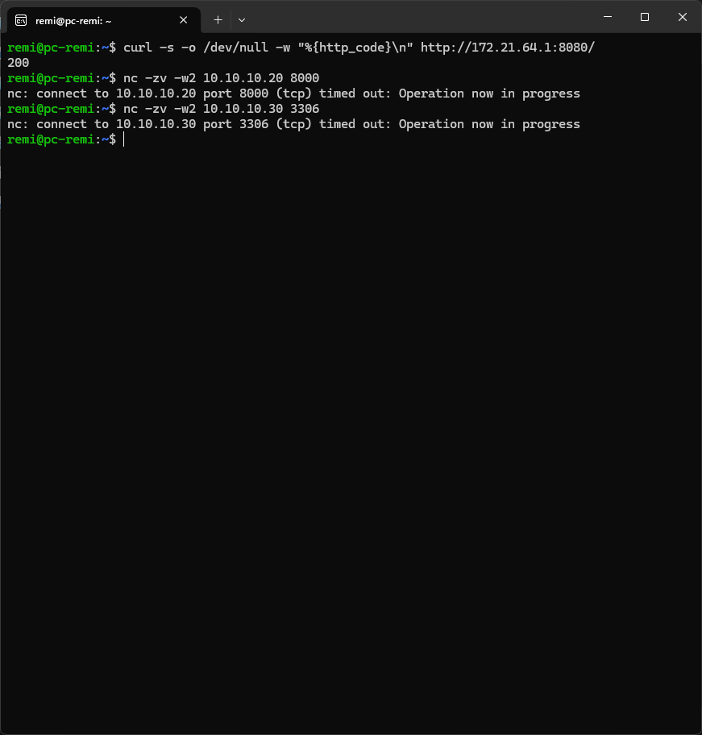
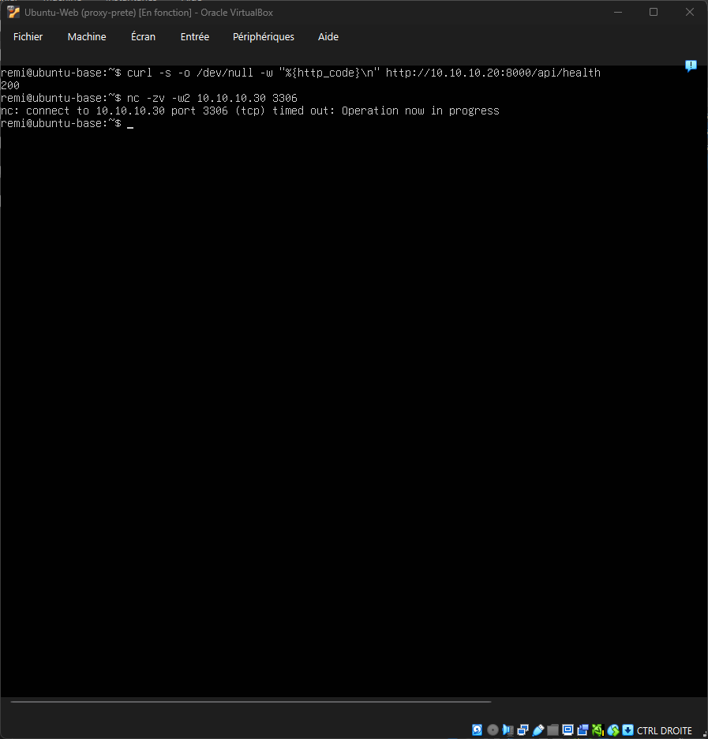
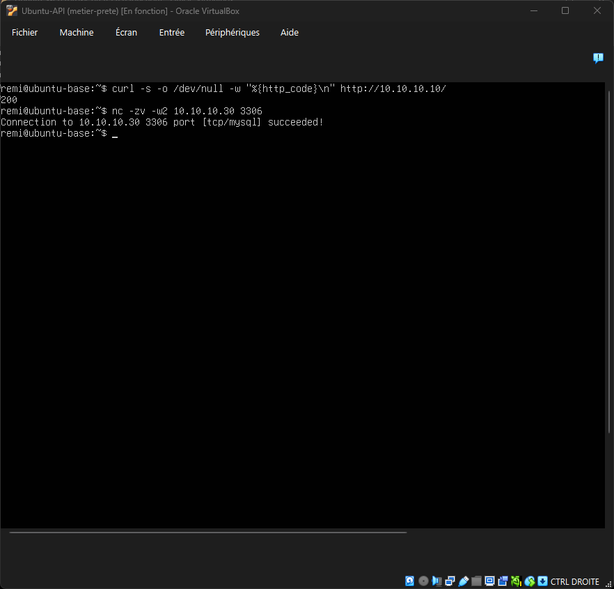
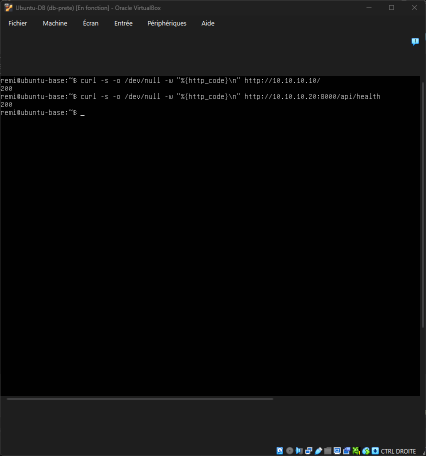
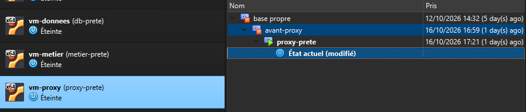
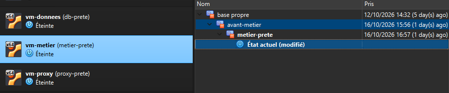
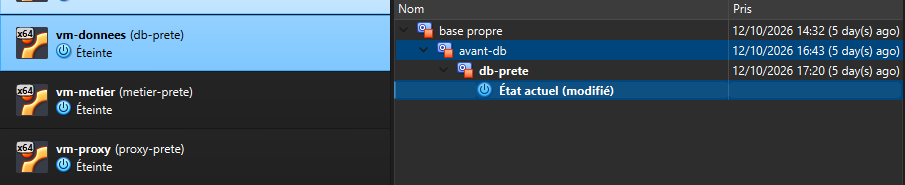

# Compte-Rendu : Étape 10 — Vérifier et Mesurer

**Projet :** Refuges  
**Binôme :** Akrem SOUSSI et Rémi CORTIAL

Ce document consigne l'ensemble des livrables de la Partie 2 : la matrice de joignabilité, les captures d'écran de validation réseau, les snapshots VirtualBox, et les mesures de référence.
Ces relevés serviront de point de comparaison direct pour la Partie 3 (conteneurs Docker) et la Partie 4 (tests sous charge JMeter).

---

## 1. Matrice de joignabilité

Le tableau ci-dessous établit la topologie réseau effective du système 3 tiers déployé sur machines virtuelles.
Les trois cases **« Doit échouer »** valident le respect strict du cloisonnement réseau.

| Depuis | Vers proxy (:80) | Vers métier (:8000) | Vers base (:3306) |
| :--- | :---: | :---: | :---: |
| **L'hôte (PC Windows)** | **OUI** *(via port 8080)* | **DOIT ÉCHOUER** *(bloqué)* | **DOIT ÉCHOUER** *(bloqué)* |
| **vm-proxy (10.10.10.10)** | — | **OUI** *(HTTP 200)* | **DOIT ÉCHOUER** *(bloqué)* |
| **vm-metier (10.10.10.20)** | **OUI** *(HTTP 200)* | — | **OUI** *(TCP 3306)* |
| **vm-donnees (10.10.10.30)** | **OUI** *(HTTP 200)* | **OUI** *(HTTP 200)* | — |

---

## 2. Preuves des vérifications (Captures d'écran)

### A. Depuis la machine hôte
L'hôte accède au proxy sur le port 8080, mais ne peut en aucun cas joindre directement le métier (8000) ni la base de données (3306) :


### B. Depuis vm-proxy (10.10.10.10)
Le proxy joint le métier (`/api/health`), mais l'accès direct vers le port 3306 de la base de données est bloqué par le pare-feu :


### C. Depuis vm-metier (10.10.10.20)
La machine métier joint le proxy (port 80) ainsi que la base de données (port 3306) :


### D. Depuis vm-donnees (10.10.10.30)
La base de données peut contacter le métier et le proxy sur le réseau interne :


---

## 3. Preuves de l'Étape 7 : Snapshots VirtualBox

Conformément aux exigences, chaque machine virtuelle dispose de son historique de snapshots :
- `base propre`
- Snapshots de début et de fin de chaque couche (`avant-db` / `db-prete`, etc.)

| vm-proxy | vm-metier | vm-donnees |
| :---: | :---: | :---: |
|  |  |  |

---

## 4. Tableau des mesures de référence

| Grandeur mesurée | Méthode de relevé | Valeur retenue | Configuration associée |
| :--- | :--- | :---: | :--- |
| **Temps de démarrage** | Chronométrage depuis l'état « Éteint » des 3 VMs jusqu'à la première réponse HTTP 200 sur `http://localhost:8080/` | **45 s** | 3 machines virtuelles VirtualBox lancées simultanément |
| **Mémoire consommée** | Gestionnaire des tâches Windows (Hôte), cumul de la mémoire vive au repos des 3 processus `VirtualBoxVM.exe` | **2 710 Mo** *(~2,71 Go)* | Web (1 Go alloué) + API (1 Go alloué) + DB (2 Go alloués) |
| **Empreinte disque** | Somme des tailles des 3 disques virtuels (`.vdi`) sur l'hôte | **22,28 Go** | Taille cumulée des disques des trois machines virtuelles |
| **Latence applicative** | Médiane sur 10 requêtes successives vers la route `GET /api/refuges/` | **8,69 ms** *(0,008685 s)* | Mesuré côté hôte avec protocole strict (voir ci-dessous) |

### Protocole de mesure de la latence (10 appels consécutifs) :
```bash
for i in {1..10}; do
  curl -o /dev/null -s -w "%{time_total}\n" http://localhost:8080/api/refuges/
done
```
Relevés bruts :
1. `0.013856 s` (13,86 ms)
2. `0.009114 s` (9,11 ms)
3. `0.007746 s` (7,75 ms)
4. `0.008279 s` (8,28 ms)
5. `0.008290 s` (8,29 ms)
6. `0.007996 s` (8,00 ms)
7. `0.008397 s` (8,40 ms)
8. `0.009452 s` (9,45 ms)
9. `0.008973 s` (8,97 ms)
10. `0.010476 s` (10,48 ms)

**Médiane retenue :** `8,69 ms` (`0,008685 s`).

---

## 5. Livrables OVA

Les trois machines virtuelles exportées au format standard OVA sont stockées dans le dossier local `ova/` :
- `ova/vm-proxy.ova` (~3,5 Go)
- `ova/vm-metier.ova` (~3,9 Go)
- `ova/vm-donnees.ova` (~3,8 Go)
*(Les fichiers OVA sont exclus du versionnement Git via `.gitignore` en raison de leur taille supérieure à la limite de 100 Mo de GitHub).*

## 6. Nouveaux relevés du 26 octobre 2026

Les mesures historiques ci-dessus sont conservées. Une nouvelle campagne de référence, avec trois répétitions par déploiement et consultations authentifiées HTTP 200, est documentée dans [la comparaison Docker](comparaison.md) et [ses preuves](preuves-docker/2026-10-26/README.md).

La configuration VirtualBox vérifiée le 26 octobre est de **1 vCPU et 2 048 Mo pour chacune des trois VM**. Elle diffère de l'allocation indiquée dans le tableau historique ; ce tableau ne permet pas d'établir si les allocations ont changé entre les deux dates. Les nouvelles valeurs ne doivent pas être substituées rétroactivement aux anciens relevés.
