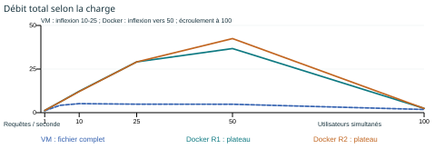
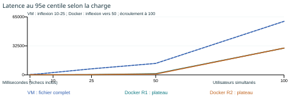
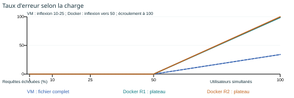

> Archive historique apportée par Rémi, conservée sans modification des mesures. Le [rapport principal](rapport-charge.md) utilise la campagne appariée du 26 octobre.

# Refuges - Mesure et comparaison VM / Docker

**DEV 1 - Partie 4, étape 18**
**Akrem SOUSSI et Rémi CORTIAL - Polytech Marseille**
Mise en forme : 26 octobre 2026. Mesures : 21 octobre 2026.

## 1. Objet, protocole et validité

Les mesures disponibles décrivent deux campagnes Refuges (React, FastAPI, MySQL) réalisées le 21 octobre 2026. Le parcours traverse les trois tiers : POST /api/auth/login, conservation du cookie refuges_session, puis GET /api/refuges?limit=20. Le fichier comporte 25 comptes ; la temporisation de 500 à 1 000 ms s'applique avant chaque requête. Les paliers sont 1, 5, 10, 25, 50 et 100 utilisateurs.

> **Comparaison provisoire.** La présentation réunit les livrables de l'étape 18. La comparaison expérimentale reste provisoire : les VM sont analysées sur le fichier complet, Docker sur un plateau de 60 s ; le plan exécuté Docker ajoute un timeout client de 30 s et un repère temporel. La même machine physique, le même budget CPU/RAM et la même version applicative ne sont pas attestés pour les deux campagnes. Les ratios ci-dessous décrivent les essais archivés, sans isoler l'effet du mode de déploiement.

## 2. Tableau de synthèse (sujet, p. 56)

| Grandeur | Trois machines virtuelles | Trois conteneurs |
|---|---|---|
| Débit maximal observé sans erreur | 5,17 req/s (10 utilisateurs) | 36,75 et 42,47 req/s (50 utilisateurs ; instable) |
| Charge au point de saturation | Inflexion entre 10 et 25 ; écroulement à 100 | Inflexion vers 50 ; écroulement à 100 |
| p95 à charge égale : 10 utilisateurs | 2 585 ms (fichier complet) | 142 et 132 ms (plateau) |
| Goulot d'étranglement | Couche métier suspectée ; cause non prouvée par des logs VM conservés | Pool SQLAlchemy épuisé à 100 ; logs disponibles |
| Temps de démarrage complet | 45 s (étape 10) | 34,03 et 34,31 s (Compose up --wait) |
| Mémoire au repos | 2 710 Mo (processus VirtualBox hôte) | 523,45 et 519,28 MiB (somme docker stats) |

Le maximum Docker à 50 n'est pas une capacité soutenable validée : l'écart entre répétitions dépasse 10 %. Les démarrages ne suivent pas exactement le même critère de disponibilité. La RAM Docker exclut le coût du moteur et de son environnement Linux ; la RAM VM est mesurée sur l'hôte. Aucun gain mémoire global n'est déduit de ces deux périmètres.

## 3. Courbes (étape 18)

Les trois séries sont conservées séparément : VM historique, Docker R1 et Docker R2. Les débits Docker correspondent aux départs de requêtes du plateau divisés par 60 s ; les débits VM au nombre de requêtes divisé par la durée complète. Les points ne sont donc pas strictement comparables. Les zones de saturation sont annotées comme observations.

## 4. Analyse : les quatre questions (sujet, p. 57)

### 4.1 De combien les deux déploiements diffèrent-ils ?

À 10 utilisateurs, le débit VM est de 5,17 req/s contre 12,28 et 12,12 req/s sur Docker, soit des rapports observés de 2,38 et 2,35. Le p95 passe de 2 585 ms à 142 et 132 ms (réduction apparente de 94,5 à 94,9 %). Le maximum sans erreur relevé est de 5,17 req/s sur VM contre 36,75 à 42,47 req/s sur Docker. Ce dernier intervalle varie trop pour retenir une valeur unique. À 100, Docker n'assure presque plus de service : 98,64 et 100 % d'erreurs ; le débit réussi est de 0,03 et 0,00 req/s. Les VM présentent 34,12 % d'erreurs et environ 1,20 req/s réussie sur l'ensemble du fichier. Ces ratios utilisent des fenêtres distinctes et ne constituent pas un gain causal de Docker.

### 4.2 Quelle propriété technique explique cet écart ?

Les VM exécutent des systèmes invités séparés avec leurs ressources allouées ; les conteneurs partagent le noyau de leur environnement Linux. Sous Windows, Docker dépend lui-même d'un environnement Linux : son coût ne disparaît pas. Le Compose archivé ne fixe pas de quotas CPU/RAM par service, alors que les VM ont des budgets alloués. Le backend Docker atteint environ 919 à 949 % CPU à 50 utilisateurs, soit plus de neuf cœurs logiques occupés en moyenne selon docker stats. Cet accès aux ressources est une explication possible d'une partie de l'écart. Le coût propre de VirtualBox ne peut pas être isolé sans aligner les budgets, versions, données et outils d'injection.

### 4.3 Quel composant cède en premier, dans chaque cas ?

Sur VM, le débit plafonne vers 5 req/s entre 10 et 50 utilisateurs tandis que le p95 augmente de 2,59 à 12,83 s. Les relevés manuels CPU du métier vont de 2,5 % à 13,2 % en moyenne, avec un maximum observé de 26,6 % à 100 ; leur périmètre ne prouve pas une saturation CPU. À 100, les CSV contiennent 37 réponses 500, 17 réponses 504 et 4 réponses 401. Les causes Argon2 et pool DB restent des hypothèses faute de journaux VM archivés. Sur Docker, la hausse du CPU métier et de la mémoire précède le décrochage. À 100, les journaux prouvent l'épuisement du pool SQLAlchemy (5 connexions + 10 de débordement, attente 30 s). Les 16 connexions MySQL relevées incluent la connexion de surveillance. Cela ne démontre pas une saturation du moteur MySQL. Les p95 proches de 30 s reflètent surtout le timeout client.

### 4.4 Que ne dit pas cette mesure ?

Les essais ne mesurent ni la capacité de production, ni la tolérance aux pannes, ni un déploiement sur plusieurs hôtes physiques. Ils portent sur un parcours à deux requêtes, avec 25 comptes réutilisés au-delà de 25 utilisateurs, et ne couvrent pas les photos, les imports GPX ou les écritures sociales. Les centiles agrègent connexion et consultation ; les résultats par type sont fournis en annexe CSV. Les courbes incluent les échecs : leur latence représente parfois un délai d'abandon. La répétabilité Docker est acceptable sur débit et p95 de 1 à 25, mais échoue à 50. Une seule série VM est disponible. L'ordre inversé VM/Docker dans une même session n'est pas établi. Les données ne permettent donc pas une conclusion générale sur la supériorité d'une architecture.

## 5. Traçabilité et compléments nécessaires

VM : charge/resultats/vm-*.csv ; six paliers, une série. Docker : charge/resultats/dk-*-r*-20261021-113529-649.csv ; six paliers, deux séries. Les deux contrôles supplémentaires à 50 sont conservés sous le suffixe 115723-513 et ne remplacent pas la campagne principale. Les statistiques, plans exécutés, configurations, journaux et métriques serveur Docker sont dans les dossiers de session correspondants. L'étalonnage statique du 21 octobre est conservé, avec ses bruts compressés sans perte. Les fichiers de synthèse ajoutés sont dérivés ; les données sources sont inchangées.

Pour valider la comparaison : rejouer les deux déploiements sur le même poste avec le même plan exécuté et les mêmes timeouts, limiter CPU/RAM de façon équivalente, réinitialiser la base depuis les mêmes scripts et relever les empreintes du code et des données. Mesurer 60 s hors montée, conserver les métriques serveur par service, puis répéter avec ordre inversé. Stabiliser le palier 50 et ajouter les captures GUI du parcours nominal et du mot de passe erroné. Ces opérations produisent de nouvelles preuves ; une mise en forme ne peut pas les remplacer.

Voir [l’index des livrables](../charge/README.md), [l’étalonnage](../charge/etalonnage.md), [les mesures client détaillées](../charge/resultats/synthese/mesures-client.csv) et [les relevés serveur Docker](../charge/resultats/synthese/mesures-serveur-docker.csv).

[Version PDF paginée en quatre pages](rapport-charge-historique-remi.pdf).
